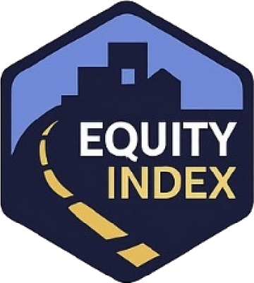
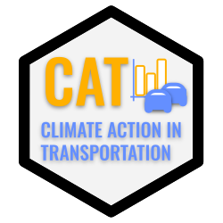

<p align="center">
  
  &nbsp;&nbsp;&nbsp;
  <a href="https://cat-apps.com"></a>
</p>

# equity: who lives next to the road, and who carries its emissions burden?

[](LICENSE)

[](https://cat-apps.com)
[](https://github.com/timothyfraser/equity/actions/workflows/check.yml)

Replication code for Fraser, Park, Li, Tang & Gao, ***Measuring Burden and Disparity of Exposure to Transportation
Emissions in American Communities*** (submitted to the *Journal of Transport Geography*).

The **equity index** scores how evenly the near-road burden of on-road PM<sub>2.5</sub> falls across race and
ethnicity, income, education, and age, from 0 (all on one group) to 1 (perfectly even). The paper applies it to New
York State's 10 regions and to 224 metropolitan planning organizations (MPOs) across the United States. Emissions come
from [CAT (Climate Action in Transportation)](https://cat-apps.com); demographics from the American Community Survey.

## Quick links

- [Replication guide](docs/REPLICATION.md): requirements, stages, runtimes, and how to check your numbers against ours
- [Where each figure and table comes from](docs/FIGURES.md)
- [The method in one page](docs/METHOD.md)
- [The national MPO analysis](national/README.md) and [the New York scripts](index/README.md)
- [Every number in the paper](results/results.json), each with the script that produced it
- [How the 2026 revision was decided and checked](.contract/README.md)
- [Instructions for coding agents](CLAUDE.md)

## Replicate

```bash
git clone https://github.com/timothyfraser/equity && cd equity
bash setup.sh        # Ubuntu 24.04; macOS and Windows: see the replication guide
bash replicate.sh    # about 2 minutes, no API key
```

This reruns the New York analysis on the paper's own emissions (frozen in the repo), writes `results/results.json`,
compares it with the paper's numbers (they match exactly), and runs the tests. `EMISSIONS=live bash replicate.sh`
uses the latest CAT release instead. The national stage (`bash replicate.sh all`) needs a free
[Census API key](https://api.census.gov/data/key_signup.html) and a few hours on a first run.

## Data sources

| Data | Source |
|---|---|
| On-road emissions by county, 2020-2025 | [CAT public objects](https://api.cat-apps.com/objects/LATEST) ([URLs](index/test/EMISSIONS_SOURCES.md)); New York's copy is [frozen here](index/data/cat_MANIFEST-e2ccfae4/), national ones are pulled at run time |
| Race and ethnicity, income, education, age | [ACS 5-year 2022](https://www.census.gov/data/developers/data-sets/acs-5year.html), via [`censusapi`](https://cran.r-project.org/package=censusapi) |
| Roads, tracts, counties | [TIGER/Line](https://www.census.gov/geographies/mapping-files/time-series/geo/tiger-line-file.html), via [`tigris`](https://cran.r-project.org/package=tigris) |
| MPO boundaries | [BTS National Transportation Atlas Database](https://geodata.bts.gov/) |

## Cite

> Fraser, T., Park, Y. G., Li, Y., Tang, Y., & Gao, H. O. (2026). *Measuring Burden and Disparity of Exposure to
> Transportation Emissions in American Communities.* Submitted to the *Journal of Transport Geography*.
> Code: https://github.com/timothyfraser/equity

An earlier version was presented at the Complex Adaptive Systems Conference, University of Tokyo, June 2026.
Citation metadata: [`CITATION.cff`](CITATION.cff). License: [MIT](LICENSE).
